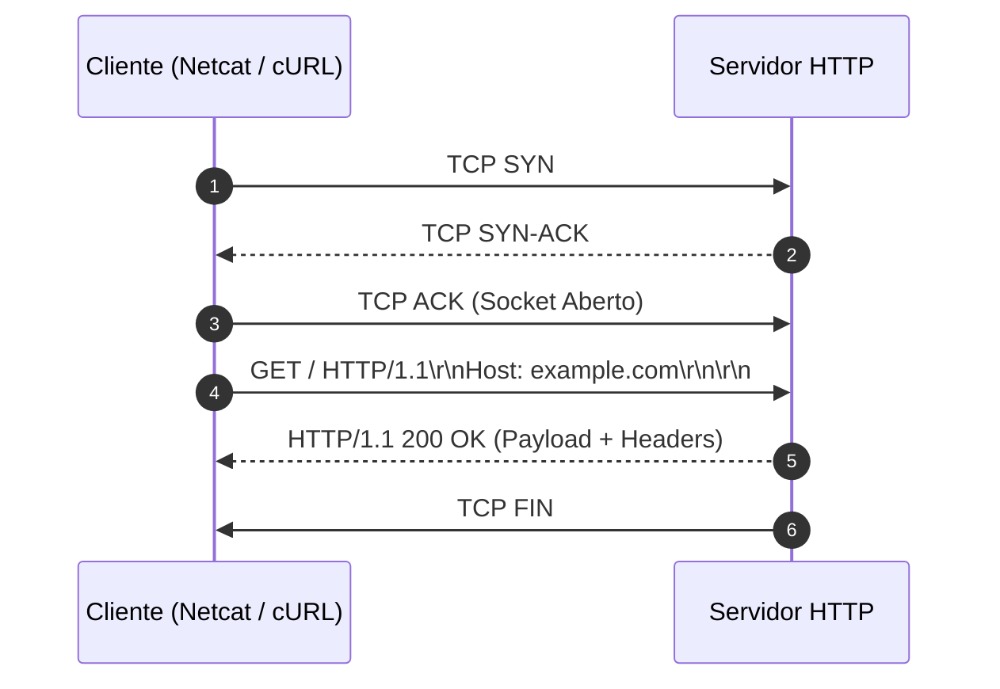

# Memória de Desenvolvimento — Semana 01: Protocolo HTTP & Sockets Bare-Metal
**Aluno:** Asafe Fernandes de Souza
**Matrícula:** 202421200285
**Curso:** Sistemas de Informação

---

## 1. Mapeamento da Camada de Transporte
Diagrama Mermaid demonstrando o ciclo de vida da requisição executada no laboratório:



---

## 2. Registro dos Experimentos de Laboratório

### Experimento 1: Netcat Nu & Falha 400 Bad Request
* **Comando Testado:** `nc -C example.com 80` sem o header `Host:`
* **Resultado:** O servidor respondeu `HTTP/1.1 400 Bad Request` (servidor: Cloudflare), com uma página HTML de erro de 155 bytes. O HTTP/1.1 exige o campo `Host` porque um mesmo IP/porta pode hospedar vários sites (Virtual Hosting). A conexão TCP chega apenas ao IP; é o `Host` que diz ao servidor qual site o cliente quer. Sem ele, o servidor não consegue escolher o destino e rejeita a requisição.

```
$ nc -C example.com 80
GET / HTTP/1.1
User-Agent: NetcatAcademic/1.0
Connection: close

HTTP/1.1 400 Bad Request
Server: cloudflare
Date: Tue, 20 Oct 2026 00:56:52 GMT
Content-Type: text/html
Content-Length: 155
Connection: close
CF-RAY: -

<html>
<head><title>400 Bad Request</title></head>
<body>
<center><h1>400 Bad Request</h1></center>
<hr><center>cloudflare</center>
</body>
</html>
```

### Experimento 2: Semântica dos Métodos HTTP
* **Análise dos Verbos:**
  * **GET** (`/get`): pede um recurso ao servidor, sem corpo na requisição. A resposta (200 OK) trouxe um JSON com os dados da requisição, incluindo `args`, `headers`, `origin` e `url`.
  * **POST** (`/post`): envia dados ao servidor no corpo da requisição. O envio de `teste` com `Content-Type: text/plain` apareceu na resposta no campo `"data": "teste"`, mostrando que o servidor recebeu e processou o corpo.
  * **OPTIONS**: não busca conteúdo (`Content-Length: 0`). Pergunta ao servidor o que ele aceita. A resposta trouxe `Allow: HEAD, GET, OPTIONS` e os headers de CORS (`Access-Control-Allow-Methods`, `Access-Control-Max-Age`, etc.).
  * Observação: no OPTIONS, o `Host` enviado foi `example.com` enquanto a conexão foi aberta em `httpbin.org`. O httpbin aceitou, mas num servidor com Virtual Hosting estrito isso poderia gerar erro ou cair no site errado.
* **Header Content-Length:** Ele informa quantos bytes de corpo vêm depois da linha em branco que encerra os headers. É assim que o servidor sabe até onde ler no buffer do socket, já que o TCP é só um fluxo de bytes, sem delimitar mensagens. No POST, `Content-Length: 5` correspondia exatamente aos 5 bytes de `teste`. Quanto maior o payload, maior o valor. Se o valor for menor que o corpo real, o servidor lê só parte dos dados. Se for maior, fica esperando bytes que nunca chegam.

```
$ nc -C httpbin.org 80
GET /get HTTP/1.1
Host: httpbin.org
Connection: close

HTTP/1.1 200 OK
Date: Wed, 21 Oct 2026 03:45:38 GMT
Content-Type: application/json
Content-Length: 199
Connection: close
Server: gunicorn/19.9.0
Access-Control-Allow-Origin: *
Access-Control-Allow-Credentials: true

{
  "args": {},
  "headers": {
    "Host": "httpbin.org",
    "X-Amzn-Trace-Id": "Root=1-6ad83562-7bfa5433447ba0e030ff17f8"
  },
  "origin": "187.105.221.81",
  "url": "http://httpbin.org/get"
}
```

```
$ nc -C httpbin.org 80
POST /post HTTP/1.1
Host: httpbin.org
Content-Type: text/plain
Content-Length: 5
Connection: close

teste
HTTP/1.1 200 OK
Date: Wed, 21 Oct 2026 03:46:45 GMT
Content-Type: application/json
Content-Length: 331
Connection: close
Server: gunicorn/19.9.0
Access-Control-Allow-Origin: *
Access-Control-Allow-Credentials: true

{
  "args": {},
  "data": "teste",
  "files": {},
  "form": {},
  "headers": {
    "Content-Length": "5",
    "Content-Type": "text/plain",
    "Host": "httpbin.org",
    "X-Amzn-Trace-Id": "Root=1-6ad835a4-72451e7b0b85931f68314d7d"
  },
  "json": null,
  "origin": "187.105.221.81",
  "url": "http://httpbin.org/post"
}
```

```
$ nc -C httpbin.org 80
OPTIONS / HTTP/1.1
Host: example.com
Connection: close

HTTP/1.1 200 OK
Date: Wed, 21 Oct 2026 03:47:30 GMT
Content-Type: text/html; charset=utf-8
Content-Length: 0
Connection: close
Server: gunicorn/19.9.0
Allow: HEAD, GET, OPTIONS
Access-Control-Allow-Origin: *
Access-Control-Allow-Credentials: true
Access-Control-Allow-Methods: GET, POST, PUT, DELETE, PATCH, OPTIONS
Access-Control-Max-Age: 3600
```

### Experimento 3: URL, Query Strings & Percent-Encoding
* **URL Testada: (Passo 1)** `curl -v 'http://httpbin.org/get?curso=Engenharia da Computacao'`
* **URL Testada: (Passo 2)** `curl -v https://httpbin.org/get?curso=Engenharia%20da%20Computa%C3%A7%C3%A3o`
* **O erro no Passo 1:** Sem aspas, o próprio shell (zsh) falhou antes de chamar o curl, com `no matches found`: o `?` é interpretado como curinga de arquivo e o espaço separa a URL em dois argumentos. Com aspas, o curl rodou, mas rejeitou a URL com `URL rejected: Bad query` (`curl: (3)`). Nenhuma requisição chegou a ser enviada, porque o curl já recusou a URL localmente por ela conter um espaço real na query string.
* **O resultado no Passo 2:** Com a URL codificada, o curl enviou `GET /get?curso=Engenharia%20da%20Computa%C3%A7%C3%A3o HTTP/2` e o servidor respondeu `200`. O httpbin decodificou o valor e o devolveu em `"args": {"curso": "Engenharia da Computação"}` (no JSON os acentos aparecem escapados como `\u00e7\u00e3`).
* **A função do `%20`:** Uma URL só pode conter um conjunto limitado de caracteres ASCII, e alguns têm significado especial (o espaço separa partes da linha de requisição, `&` separa parâmetros, etc.). Um espaço cru quebraria a linha `GET /caminho HTTP/1.1`, pois o servidor entenderia o texto depois dele como outra parte da requisição. Por isso esses caracteres são trocados por `%` + o valor hexadecimal do byte:
  * Espaço = `%20` (byte `0x20`)
  * `ç` = `%C3%A7` (bytes `0xC3 0xA7`, são dois bytes porque em UTF-8 caracteres acentuados ocupam mais de um byte)

```
$ curl -v http://httpbin.org/get?curso=Engenharia da Computacao
zsh: no matches found: http://httpbin.org/get?curso=Engenharia

$ curl -v 'http://httpbin.org/get?curso=Engenharia da Computacao'
* URL rejected: Bad query
curl: (3) URL rejected: Bad query

$ curl -v https://httpbin.org/get\?curso\=Engenharia%20da%20Computa%C3%A7%C3%A3o
[... handshake TLS omitido ...]
> GET /get?curso=Engenharia%20da%20Computa%C3%A7%C3%A3o HTTP/2
> Host: httpbin.org
> User-Agent: curl/8.23.0
> Accept: */*
>
< HTTP/2 200
< date: Mon, 26 Oct 2026 02:51:46 GMT
< content-type: application/json
< content-length: 350
< server: gunicorn/19.9.0
< access-control-allow-origin: *
< access-control-allow-credentials: true
<
{
  "args": {
    "curso": "Engenharia da Computa\u00e7\u00e3o"
  },
  "headers": {
    "Accept": "*/*",
    "Host": "httpbin.org",
    "User-Agent": "curl/8.23.0",
    "X-Amzn-Trace-Id": "Root=1-6adec042-1e14f74b3fef6496383e35d9"
  },
  "origin": "187.105.221.81",
  "url": "https://httpbin.org/get?curso=Engenharia da Computa\u00e7\u00e3o"
}
```

### Experimento 4: Negociação de Conteúdo & User-Agent
* **Análise:** Foram enviadas duas requisições ao endpoint `/headers` do httpbin: uma com `Accept: application/json` e `User-Agent: NetcatAcademic/1.0`, outra com `Accept: text/html` e `User-Agent: MeuClient/1.0`. Em ambas o `Content-Type` da resposta continuou `application/json`. Ou seja, o servidor não mudou o formato da resposta de acordo com o `Accept`, porque esse endpoint apenas devolve (ecoa) os headers recebidos. O único efeito visível foi o servidor refletir os novos valores de `Accept` e `User-Agent` no corpo do JSON. Um servidor que realmente faz negociação de conteúdo poderia devolver formatos diferentes (HTML, JSON, XML) conforme o `Accept`.

```
$ curl -i https://httpbin.org/headers \
  -H 'Accept: application/json' \
  -H 'User-Agent: NetcatAcademic/1.0'
HTTP/2 200
date: Wed, 21 Oct 2026 03:51:41 GMT
content-type: application/json
content-length: 193
server: gunicorn/19.9.0
access-control-allow-origin: *
access-control-allow-credentials: true

{
  "headers": {
    "Accept": "application/json",
    "Host": "httpbin.org",
    "User-Agent": "NetcatAcademic/1.0",
    "X-Amzn-Trace-Id": "Root=1-6ad836cd-4a380aba2a0cc49808706859"
  }
}
```

```
$ curl -i https://httpbin.org/headers \
  -H 'Accept: text/html' \
  -H 'User-Agent: MeuClient/1.0'
HTTP/2 200
date: Wed, 21 Oct 2026 03:52:15 GMT
content-type: application/json
content-length: 181
server: gunicorn/19.9.0
access-control-allow-origin: *
access-control-allow-credentials: true

{
  "headers": {
    "Accept": "text/html",
    "Host": "httpbin.org",
    "User-Agent": "MeuClient/1.0",
    "X-Amzn-Trace-Id": "Root=1-6ad836ef-55e02ab769e692dc3ef458c9"
  }
}
```

### Experimento 5: Redirecionamentos & Cache Condicional
* **Redirecionamento (301):** Sem `-L`, o `curl -I` mostra apenas a resposta `301 MOVED PERMANENTLY` com o header `Location: https://example.com` e para por aí. Com `-L`, o curl segue o `Location` e faz uma nova requisição, exibindo também a resposta final (`HTTP/2 200` de example.com).
* **Validação de Cache (304):** A `ETag` é um identificador da versão atual de um recurso, enviado pelo servidor. O cliente guarda esse valor junto com a cópia local e, na próxima requisição, o devolve no header `If-None-Match`. Se o recurso não mudou, o servidor responde `304 Not Modified` sem corpo, e o cliente reutiliza a cópia em cache. Na prática: a primeira requisição a `/etag/abc` retornou `200` com `etag: abc` e um corpo JSON de 261 bytes. A segunda, com `If-None-Match: "abc"`, retornou `304` apenas com headers e sem corpo. Assim, só os headers trafegam na rede, e não o recurso inteiro.

```
$ curl -I http://httpbin.org/redirect-to\?url\=https://example.com\&status_code\=301
HTTP/1.1 301 MOVED PERMANENTLY
Date: Wed, 21 Oct 2026 03:55:26 GMT
Content-Type: text/html; charset=utf-8
Content-Length: 0
Connection: keep-alive
Server: gunicorn/19.9.0
Location: https://example.com
Access-Control-Allow-Origin: *
Access-Control-Allow-Credentials: true

$ curl -I -L 'http://httpbin.org/redirect-to?url=https://example.com&status_code=301'
HTTP/1.1 301 MOVED PERMANENTLY
Date: Wed, 21 Oct 2026 03:55:33 GMT
Content-Type: text/html; charset=utf-8
Content-Length: 0
Connection: keep-alive
Server: gunicorn/19.9.0
Location: https://example.com
Access-Control-Allow-Origin: *
Access-Control-Allow-Credentials: true

HTTP/2 200
date: Wed, 21 Oct 2026 03:55:33 GMT
content-type: text/html; charset=utf-8
server: cloudflare
last-modified: Tue, 20 Oct 2026 23:45:21 GMT
allow: GET, HEAD
accept-ranges: bytes
age: 7461
cf-cache-status: HIT
cf-ray: a4dd53cdf8aa1b32-GIG
alt-svc: h3=":443"; ma=86400
```

```
$ curl -i https://httpbin.org/etag/abc
HTTP/2 200
date: Mon, 26 Oct 2026 02:52:40 GMT
content-type: application/json
content-length: 261
server: gunicorn/19.9.0
etag: abc
access-control-allow-origin: *
access-control-allow-credentials: true

{
  "args": {},
  "headers": {
    "Accept": "*/*",
    "Host": "httpbin.org",
    "User-Agent": "curl/8.23.0",
    "X-Amzn-Trace-Id": "Root=1-6adec078-374937d129703fd52d676b18"
  },
  "origin": "187.105.221.81",
  "url": "https://httpbin.org/etag/abc"
}

$ curl -i https://httpbin.org/etag/abc -H 'If-None-Match: "abc"'
HTTP/2 304
date: Mon, 26 Oct 2026 02:52:56 GMT
server: gunicorn/19.9.0
etag: abc
access-control-allow-origin: *
access-control-allow-credentials: true
```

---

## 3. Conclusão Técnica

Os experimentos permitiram compreender que a comunicação HTTP depende da organização correta dos bytes transmitidos pela conexão TCP. Com o Netcat, ficou claro que o HTTP é um protocolo de texto ASCII em que a sintaxe importa: os terminadores CRLF (`\r\n`) delimitam as linhas e a linha em branco marca o fim dos headers. Também ficou evidente a importância dos cabeçalhos, como `Host`, cuja ausência gerou o erro `400 Bad Request`, e `Content-Length`, que informa ao servidor quantos bytes do corpo ler, já que o TCP entrega apenas um fluxo de bytes sem delimitação de mensagens. Métodos como GET, POST e OPTIONS têm finalidades distintas na comunicação entre cliente e servidor.

Para o desenvolvimento de sistemas distribuídos e de alta performance, esse conhecimento é essencial: bibliotecas e frameworks escondem esses detalhes, mas é preciso entendê-los para depurar falhas de comunicação, implementar parsers e servidores corretamente e evitar problemas como leitura incompleta de corpo ou requisições malformadas. Mecanismos como redirecionamentos e cache condicional (`ETag`/`If-None-Match`/`304`) mostram como o protocolo reduz tráfego e latência, o que impacta diretamente a escalabilidade das aplicações.
