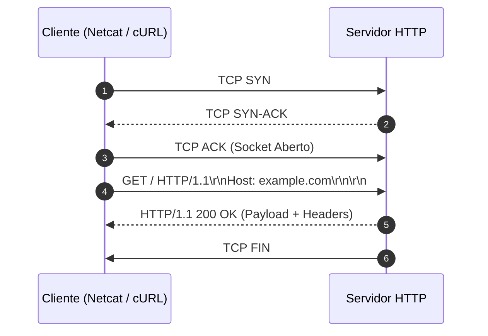

# Memória de Desenvolvimento — Semana 01: Protocolo HTTP & Sockets Bare-Metal
**Aluno:** Asafe Fernades de Souza
**Matrícula:** 202421200285
**Curso:** Sistemas de Informação

---

## 1. Mapeamento da Camada de Transporte
Diagrama Mermaid demonstrando o ciclo de vida da requisição executada no laboratório:



---

## 2. Registro dos Experimentos de Laboratório

### Experimento 1: Netcat Nu & Falha 400 Bad Request
* **Comando Testado:** `nc -C example.com 80` sem o header `Host:`
* **Resultado:**
```
aulaweb@manutencao-System-Product-Name:~/Documentos/prog-web-ronaldo/test-express$ nc -C example.com 80
GET / HTTP/1.1
User-Agent: NetcatAcademic/1.0
Connection: close

HTTP/1.1 400 Bad Request
Server: cloudflare
Date: Tue, 20 Oct 2026 00:56:52 GMT
Content-Type: text/html
Content-Length: 155
Connection: close
CF-RAY: -

<html>
<head><title>400 Bad Request</title></head>
<body>
<center><h1>400 Bad Request</h1></center>
<hr><center>cloudflare</center>
</body>
</html>

```

### Experimento 2: Semântica dos Métodos HTTP
* **Análise dos Verbos:** Explique a diferença observada entre chamadas `GET`, `POST` e `OPTIONS`.
* **Header Content-Length:** Como o tamanho do payload afeta a leitura no buffer do socket? quanto maior o payload da request, maaior vai ser o content-length.

```
➜  ~ nc -C httpbin.org 80
GET /get HTTP/1.1
Host: httpbin.org
Connection: close

HTTP/1.1 200 OK
Date: Wed, 21 Oct 2026 03:45:38 GMT
Content-Type: application/json
Content-Length: 199
Connection: close
Server: gunicorn/19.9.0
Access-Control-Allow-Origin: *
Access-Control-Allow-Credentials: true

{
  "args": {},
  "headers": {
    "Host": "httpbin.org",
    "X-Amzn-Trace-Id": "Root=1-6ad83562-7bfa5433447ba0e030ff17f8"
  },
  "origin": "187.105.221.81",
  "url": "http://httpbin.org/get"
}
```
no GET se observa que ele recebe os dados da pagina web

```➜  ~ nc -C httpbin.org 80
POST /post HTTP/1.1
Host: httpbin.org
Content-Type: text/plain
Content-Length: 5
Connection: close

teste
HTTP/1.1 200 OK
Date: Wed, 21 Oct 2026 03:46:45 GMT
Content-Type: application/json
Content-Length: 331
Connection: close
Server: gunicorn/19.9.0
Access-Control-Allow-Origin: *
Access-Control-Allow-Credentials: true

{
  "args": {},
  "data": "teste",
  "files": {},
  "form": {},
  "headers": {
    "Content-Length": "5",
    "Content-Type": "text/plain",
    "Host": "httpbin.org",
    "X-Amzn-Trace-Id": "Root=1-6ad835a4-72451e7b0b85931f68314d7d"
  },
  "json": null,
  "origin": "187.105.221.81",
  "url": "http://httpbin.org/post"
}
```
no PUT se observa que quando se manda um dado ele responde

```
➜  ~ nc -C httpbin.org 80
OPTIONS / HTTP/1.1
Host: example.com
Connection: close

HTTP/1.1 200 OK
Date: Wed, 21 Oct 2026 03:47:30 GMT
Content-Type: text/html; charset=utf-8
Content-Length: 0
Connection: close
Server: gunicorn/19.9.0
Allow: HEAD, GET, OPTIONS
Access-Control-Allow-Origin: *
Access-Control-Allow-Credentials: true
Access-Control-Allow-Methods: GET, POST, PUT, DELETE, PATCH, OPTIONS
Access-Control-Max-Age: 3600
```
no OPTIONS se observa que ele manda informacoes sobre os metodos disponiveis, configs de CORS e coisas semelhantes.

### Experimento 3: URL, Query Strings & Percent-Encoding
* **URL Testada:** `https://httpbin.org/get?curso=Engenharia%20da%20Computa%C3%A7%C3%A3o`
* **Mapeamento Hex:** Qual o código Hex de `%20` (espaço) e `%C3%A7` (ç)? o codigo Hex pra espaco eh 0x20 e celinha eh 0xC3A7.

### Experimento 4: Negociação de Conteúdo & User-Agent
* **Análise:** Como o servidor reage ao receber diferentes cabeçalhos `Accept` e `User-Agent`?
```
➜  ~ curl -i https://httpbin.org/headers \
  -H 'Accept: application/json' \
  -H 'User-Agent: NetcatAcademic/1.0'
HTTP/2 200
date: Wed, 21 Oct 2026 03:51:41 GMT
content-type: application/json
content-length: 193
server: gunicorn/19.9.0
access-control-allow-origin: *
access-control-allow-credentials: true

{
  "headers": {
    "Accept": "application/json",
    "Host": "httpbin.org",
    "User-Agent": "NetcatAcademic/1.0",
    "X-Amzn-Trace-Id": "Root=1-6ad836cd-4a380aba2a0cc49808706859"
  }
}
```

```
➜  ~ curl -i https://httpbin.org/headers \
  -H 'Accept: text/html' \
  -H 'User-Agent: MeuClient/1.0'
HTTP/2 200
date: Wed, 21 Oct 2026 03:52:15 GMT
content-type: application/json
content-length: 181
server: gunicorn/19.9.0
access-control-allow-origin: *
access-control-allow-credentials: true

{
  "headers": {
    "Accept": "text/html",
    "Host": "httpbin.org",
    "User-Agent": "MeuClient/1.0",
    "X-Amzn-Trace-Id": "Root=1-6ad836ef-55e02ab769e692dc3ef458c9"
  }
}
```
Os resultados do experimento nao mostraram grande diferenca entre um e outro, fora eh claro, que ele reconhece o user agent novo e o accept.

### Experimento 5: Redirecionamentos & Cache Condicional
* **Redirecionamento (301):** Qual a diferença ao executar `curl -I` com e sem a flag `-L`?
* **Validação de Cache (304):** Explique como o header `If-None-Match` e a `ETag` evitam retransmissão de dados na rede. eles evitam a retransmissao pois permite que o cliente guarde um id de um recurso no servidor, assim ele so precisa mandar no If-None-Match o id pra mesma operacao.

```
➜  ~ curl -I http://httpbin.org/redirect-to\?url\=https://example.com\&status_code\=301
HTTP/1.1 301 MOVED PERMANENTLY
Date: Wed, 21 Oct 2026 03:55:26 GMT
Content-Type: text/html; charset=utf-8
Content-Length: 0
Connection: keep-alive
Server: gunicorn/19.9.0
Location: https://example.com
Access-Control-Allow-Origin: *
Access-Control-Allow-Credentials: true

➜  ~ curl -I -L 'http://httpbin.org/redirect-to?url=https://example.com&status_code=301'
HTTP/1.1 301 MOVED PERMANENTLY
Date: Wed, 21 Oct 2026 03:55:33 GMT
Content-Type: text/html; charset=utf-8
Content-Length: 0
Connection: keep-alive
Server: gunicorn/19.9.0
Location: https://example.com
Access-Control-Allow-Origin: *
Access-Control-Allow-Credentials: true

HTTP/2 200
date: Wed, 21 Oct 2026 03:55:33 GMT
content-type: text/html; charset=utf-8
server: cloudflare
last-modified: Tue, 20 Oct 2026 23:45:21 GMT
allow: GET, HEAD
accept-ranges: bytes
age: 7461
cf-cache-status: HIT
cf-ray: a4dd53cdf8aa1b32-GIG
alt-svc: h3=":443"; ma=86400

```
a diferenca de fato foi que com o -L ele foi redirecionado.

---

## 3. Conclusão Técnica

Os experimentos permitiram compreender que a comunicação HTTP depende da organização correta dos bytes transmitidos pela conexão TCP. A utilização do Netcat demonstrou a importância da sintaxe da requisição, dos cabeçalhos obrigatórios e dos terminadores CRLF (`\r\n`), que delimitam as linhas do protocolo. Também foi possível observar que a ausência de informações necessárias pode resultar em erros como `400 Bad Request`, enquanto métodos como GET, POST e OPTIONS possuem finalidades distintas na comunicação entre cliente e servidor.
